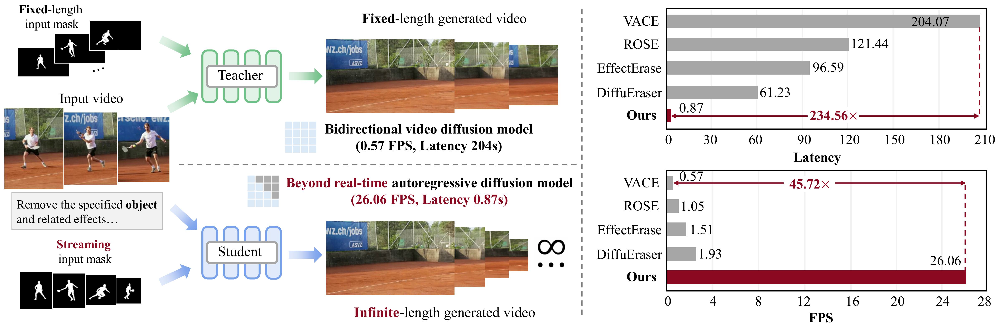

# StreamErase: Ultra-Fast Video Erasing Model

Official PyTorch implementation of the paper:

**StreamErase: Towards Ultra-Fast Streaming Video Erasing**
<br>
[Zhuobai Dong](https://zhuobaidong.github.io/)<sup>1</sup>, 
[Xiaobing Tu](https://scholar.google.com/citations?hl=zh-CN&user=aSqi480AAAAJ)<sup>2</sup>,
[Xiantao Zhang](https://cn.linkedin.com/in/xiantao-zhang-66bb4317/)<sup>2</sup>,
[Jinkui Ren](https://www.linkedin.com/in/jack-ren-2069968/)<sup>2</sup>,
[Yinggui Wang](https://dblp.org/pid/136/1775.html)<sup>2</sup>,
[Yue Ma](https://mayuelala.github.io/)<sup>3</sup>,
[Linfeng Zhang](http://www.zhanglinfeng.tech/)<sup>4</sup>,
<br>
<sup>1</sup>WuHan University, <sup>2</sup>Alibaba Group, <sup>3</sup>The Hong Kong University of Science and Technology, 
<br>
<sup>4</sup>Shanghai Jiao Tong University
<br>
[ArXiv](https://arxiv.org/abs/2610.20137) | [Homepage](https://zhuobaidong.github.io/StreamErase/) | [Model🤗](https://huggingface.co/zhuobai/StreamErase)

<!--  -->

<video width="100%" controls playsinline preload="metadata">
  <source src="assets/demo.mp4" type="video/mp4">
  Your browser does not support the video tag.
</video>

# Quick Start

### 1. Installation
```bash
conda create -n StreamErase python=3.10 -y
conda activate StreamErase
pip install -r requirements.txt
pip install git+https://github.com/openai/CLIP.git
pip install flash-attn --no-build-isolation
python setup.py develop
```

### 2. Download Checkpoints
```bash
hf download Wan-AI/Wan2.1-T2V-1.3B  --local-dir wan_models/Wan2.1-T2V-1.3B
hf download zhuobai/StreamErase StreamErase.pt --local-dir model_weights
```

### 3. Inference
```bash
python inference.py \
  --config_path configs/config.yaml \
  --video_dir input/short_video/video \
  --mask_dir input/short_video/mask \
  --output_folder output \
  --checkpoint_path model_weights/StreamErase.pt \
```

### 4. Long Video Inference
```bash
python inference_long.py \
  --config_path configs/config.yaml \
  --video_dir input/long_video/video \
  --mask_dir input/long_video/mask \
  --output_folder output_long \
  --checkpoint_path model_weights/StreamErase.pt \
```

# Acknowledgements
This codebase is built on top of the open-source implementation of [Self Forcing](https://github.com/guandeh17/Self-Forcing), [Causal Forcing](https://github.com/thu-ml/Causal-Forcing) and the [Wan2.1](https://github.com/Wan-Video/Wan2.1) repo. 

# Citation
If you find this codebase useful for your research, please kindly cite our paper:
```
@misc{dong2026streameraseultrafaststreamingvideo,
      title={StreamErase: Towards Ultra-Fast Streaming Video Erasing}, 
      author={Zhuobai Dong and Xiaobing Tu and Xiantao Zhang and Jinkui Ren and Yinggui Wang and Yue Ma and Linfeng Zhang},
      year={2026},
      eprint={2610.20137},
      archivePrefix={arXiv},
      primaryClass={cs.CV},
      url={https://arxiv.org/abs/2610.20137}, 
}
```

# Contact
If you have any questions, please feel free to reach me out at zhuobai@whu.edu.cn

